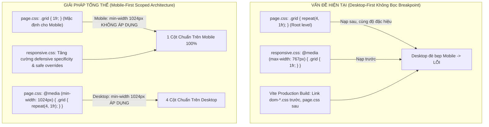

# BÁO CÁO PHÂN TÍCH NGUYÊN NHÂN GỐC (ROOT CAUSE ANALYSIS)
## DỰ ÁN: NUMEROLOGY — DISCOVER YOUR INNER ENERGY

**Mã tài liệu:** RCA-FULL-20261112  
**Thời gian thực hiện:** 2026-11-12  
**Kiến trúc sư phụ trách:** Principal Frontend Architect & Senior Software Engineer  

---

## 1. Danh mục phân tích chi tiết từng lỗi (Defect Deep-Dive)

### 1.1. BUG-01 (CRITICAL) — Archetype Cards Overflow trên Mobile

- **Bug ID:** `BUG-RESP-01`
- **Mức độ:** `CRITICAL`
- **Trang ảnh hưởng:** `index.html` (Landing Page)
- **File ảnh hưởng:** `src/css/landing.css` và `src/css/responsive.css`
- **Selector:** `.archetypes-grid`, `.archetype-card`
- **Hành vi mong muốn (Expected):**
  - Màn hình di động (320px, 375px, 390px, 430px): 4 thẻ năng lượng xếp chồng 1 cột theo chiều dọc, mỗi thẻ rộng 100% bề ngang container.
  - Tablet (768px - 1023px): 2 cột cân đối.
  - Desktop (>= 1024px): 4 cột ngang hoàn chỉnh.
- **Hành vi thực tế trên Production (Actual):**
  - Tại viewport `375 × 667px`, cả 4 thẻ vẫn bị ép nằm trên cùng 1 hàng ngang (`repeat(4, 1fr)`). Mỗi thẻ bị co rúm xuống còn ~70px chiều rộng. Chữ tiêu đề và nội dung bị gãy từ, tràn ra ngoài khung thẻ.
- **Các bước tái hiện (Reproduction Steps):**
  1. Mở production build trên trình duyệt: `http://localhost:4173/numerology-web/index.html` hoặc `https://nguyenxuanhieu2903.github.io/numerology-web/index.html`.
  2. Bật DevTools, chọn thiết bị iPhone SE (`375 × 667px`).
  3. Cuộn xuống section "4 Nhóm Năng Lượng Thần Số Học".
  4. Quan sát: 4 card bị ép thành 4 cột hẹp.
- **Nguyên nhân gốc (Root Cause):**
  1. Trong `src/css/landing.css`, selector `.archetypes-grid` khai báo vô điều kiện ở root level: `grid-template-columns: repeat(4, 1fr);`.
  2. Trong `src/css/responsive.css`, media query `@media (max-width: 767px)` khai báo `.archetypes-grid { grid-template-columns: 1fr; }` với cùng độ đặc hiệu `(0, 1, 0)`.
  3. Trong bản build production của Vite, Rollup tách `responsive.css` vào chunk dùng chung `dom-*.css` và nạp nó TRƯỚC `main-*.css` (chứa `landing.css`). Do đó luật desktop nạp sau và đè bẹp luật mobile.
- **Giải pháp xử lý (Proposed Fix):**
  - Áp dụng nguyên tắc **Mobile-First**: Trong `landing.css`, đặt `.archetypes-grid` mặc định là `grid-template-columns: 1fr;`.
  - Bọc cấu hình 2 cột trong `@media (min-width: 768px)` và cấu hình 4 cột trong `@media (min-width: 1024px)`.
  - Trên mobile (< 768px), quy tắc desktop hoàn toàn không khớp (evaluates to false), loại bỏ 100% khả năng bị ghi đè.

---

### 1.2. BUG-02 (CRITICAL) — Landing Process Cards Tràn Màn Hình Mobile

- **Bug ID:** `BUG-RESP-02`
- **Mức độ:** `CRITICAL`
- **Trang ảnh hưởng:** `index.html` (Landing Page)
- **File ảnh hưởng:** `src/css/landing.css` và `src/css/responsive.css`
- **Selector:** `.steps-grid`, `.step-card`
- **Hành vi mong muốn (Expected):**
  - Màn hình di động (320px - 767px): 3 bước khám phá ("01. Trả Lời Câu Hỏi", "02. Hệ Thống Phân Tích", "03. Nhận Hồ Sơ Năng Lượng") xếp chồng theo chiều dọc 1 cột (`grid-template-columns: 1fr`), không bị cắt, không bị tràn ngang.
  - Tablet: 2 cột hoặc 1 cột dọc.
  - Desktop (>= 1024px): 3 cột dàn ngang đều nhau.
- **Hành vi thực tế trên Production (Actual):**
  - Tại viewport `375 × 667px`, 3 process cards vẫn dàn ngang 3 cột (`repeat(3, 1fr)`). Card thứ 3 bị đẩy cắt một phần ra ngoài lề phải của màn hình, các card quá hẹp làm văn bản bị ép dòng nghiêm trọng.
- **Các bước tái hiện (Reproduction Steps):**
  1. Mở `index.html` trên production build ở viewport 375px.
  2. Cuộn đến section "Cách Trải Nghiệm Hoạt Động" (`#how-it-works`).
  3. Quan sát các bước thực hiện.
- **Nguyên nhân gốc (Root Cause):**
  - Tương tự BUG-01: `.steps-grid { grid-template-columns: repeat(3, 1fr); }` được khai báo vô điều kiện ở root level trong `landing.css`, ghi đè luật `@media (max-width: 767px) { .steps-grid { grid-template-columns: 1fr; } }` trong `dom-*.css`.
- **Giải pháp xử lý (Proposed Fix):**
  - Chuyển `.steps-grid` sang Mobile-First: Mặc định `grid-template-columns: 1fr;`.
  - Chỉ kích hoạt `repeat(3, 1fr)` trong `@media (min-width: 1024px)`.

---

### 1.3. BUG-03 (CRITICAL) — Result Hero Card Cố Định 280px Gây Tràn Ngang

- **Bug ID:** `BUG-RESP-03`
- **Mức độ:** `CRITICAL`
- **Trang ảnh hưởng:** `result.html` (Result Page)
- **File ảnh hưởng:** `src/css/result.css`
- **Selector:** `.result-hero-card`, `.result-narrative-grid`, `.result-actions-bar`
- **Hành vi mong muốn (Expected):**
  - Màn hình mobile: Hero Card xếp dọc 1 cột (vector illustration ở trên, tên archetype và điểm số ở dưới), padding 16px. 3 cột narrative xếp thành 1 cột dọc. Nút hành động xếp dọc toàn màn hình.
- **Hành vi thực tế trên Production (Actual):**
  - Cột bên trái cố định `280px`, cộng thêm cột phải và khoảng cách `gap: 48px` khiến tổng chiều rộng vượt quá 375px, gây thanh cuộn ngang khó chịu. 3 cột narrative bị ép thành 3 cột nhỏ song song.
- **Nguyên nhân gốc (Root Cause):**
  - `.result-hero-card` khai báo `grid-template-columns: 280px 1fr;` và `.result-narrative-grid` khai báo `grid-template-columns: repeat(3, 1fr);` ở root level trong `result.css`, đè bẹp media queries mobile trong `dom-*.css`.
- **Giải pháp xử lý (Proposed Fix):**
  - Đặt `.result-hero-card` mặc định là `grid-template-columns: 1fr;` với căn giữa.
  - Bọc `grid-template-columns: 280px 1fr;` trong `@media (min-width: 1024px)`.
  - Đặt `.result-narrative-grid` mặc định là `grid-template-columns: 1fr;`, bọc `repeat(3, 1fr)` trong `@media (min-width: 1024px)`.

---

### 1.4. BUG-04 (HIGH) — Quiz Card Padding & Controls Xô Lệch

- **Bug ID:** `BUG-RESP-04`
- **Mức độ:** `HIGH`
- **Trang ảnh hưởng:** `quiz.html` (Quiz Page)
- **File ảnh hưởng:** `src/css/quiz.css`
- **Selector:** `.quiz-card`, `.quiz-controls`, `.quiz-controls-right`
- **Hành vi mong muốn (Expected):**
  - Mobile: `.quiz-card` có padding nhỏ gọn `var(--space-lg) var(--space-md)` (24px 16px). Hai nút "Quay lại" và "Câu hỏi tiếp theo" xếp dọc theo kiểu `column-reverse` để ngón tay dễ bấm nút Tiếp theo ở trên.
- **Hành vi thực tế trên Production (Actual):**
  - `.quiz-card` bị ép padding desktop `var(--space-2xl)` (48px), chiếm gần một nửa bề ngang của iPhone 375px. Hai nút cố gắng dàn ngang (`justify-content: space-between`), chữ trên nút bị bẻ thành 2-3 dòng.
- **Nguyên nhân gốc (Root Cause):**
  - Thuộc tính desktop trong `quiz.css` nạp sau `dom-*.css` và ghi đè các quy tắc responsive.
- **Giải pháp xử lý (Proposed Fix):**
  - Tái cấu trúc `quiz.css` theo chuẩn Mobile-First: padding mặc định 20px 16px, controls mặc định xếp dọc. Chỉ kích hoạt dàn ngang và padding 48px trong `@media (min-width: 768px)`.

---

## 2. Bản đồ giải pháp kỹ thuật tổng thể

---

## 3. Thứ tự ưu tiên triển khai

1. **Ưu tiên 1 (Phase 3 & 4):** Triển khai Mobile-First Scoped Layouts trực tiếp vào `landing.css`, `quiz.css`, `result.css`, và `responsive.css`.
2. **Ưu tiên 2 (Phase 3):** Tối ưu hóa import và kiến trúc CSS trong cả 3 trang.
3. **Ưu tiên 3 (Phase 5):** Rà soát an toàn bảo mật, validation và accessibility.
4. **Ưu tiên 4 (Phase 6 & 7):** Bổ sung regression tests và kiểm thử trực tiếp trên bản build `vite preview`.

