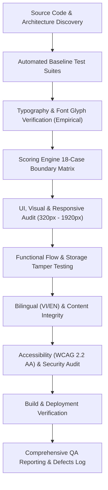

# QA TEST PLAN — NUMEROLOGY (Discover Your Inner Energy)

---

## 1. Project Overview

- **Project Name:** NUMEROLOGY — Discover Your Inner Energy
- **Application Type:** Multi-Page Application (MPA)
- **Local Directory:** `D:\LapTrinhWeb\Project\Numerology`
- **GitHub Repository:** `https://github.com/nguyenxuanhieu2903/numerology-web`
- **Production URL:** `https://nguyenxuanhieu2903.github.io/numerology-web/`
- **Architecture Stack:**
  - Structure: HTML5 (Semantic, 3 entry points: `index.html`, `quiz.html`, `result.html`)
  - Styling: CSS3 (Custom Properties / Design Tokens, Jade Pebble Morning palette)
  - Programming: JavaScript ES6+ (Native Modules, zero transpilation overhead)
  - DOM Manipulation: jQuery 3.7.1
  - Bundler: Vite 5.4.x (Rollup MPA build)
  - Package Management: npm
  - Version Control & CI/CD: Git, GitHub Actions (`deploy.yml`)
  - Hosting: GitHub Pages

---

## 2. Testing Scope

The audit covers 12 comprehensive phases across the entire codebase and live production environment:

1. **Phase 1: Project Discovery & Source Audit** — Architecture, separation of concerns, DRY, dead code, module boundaries.
2. **Phase 2: Typography & Font Quality Assurance** — Google Fonts subset coverage, Vietnamese diacritic rendering, character fallback, font loading waterfalls.
3. **Phase 3: UI & Visual Testing** — Header, Hero Mandala, 4 Archetype cards, How It Works, Quiz progress/stage, Result dossier, Energy Matrix chart.
4. **Phase 4: Responsive Testing** — 7 viewports (320px, 375px, 430px, 768px, 1366px, 1440px, 1920px), mobile menu drawer, touch targets.
5. **Phase 5: Functional Testing** — Quiz navigation (Previous, Next, Submit), option selection, state persistence across reload, Direct Access Result guard.
6. **Phase 6: Scoring Engine & Data Validation** — 18 boundary and edge cases, Largest Remainder Method, 100% sum invariant, tie detection.
7. **Phase 7: Bilingual & Content Testing** — 87 VI/EN keys, translation symmetry, spelling, grammar, dynamic DOM translation without layout breaking.
8. **Phase 8: Accessibility Testing (WCAG 2.2 AA)** — Color contrast, keyboard navigation (Tab, Arrow keys, Enter/Space), ARIA roles, `prefers-reduced-motion`.
9. **Phase 9: Security Testing (OWASP Frontend)** — DOM XSS, `innerHTML` escaping, sessionStorage/localStorage tampering, URL parameter poisoning.
10. **Phase 10: Performance Testing** — Bundle size, CSS/JS payloads, asset optimization, render blocking `@import`.
11. **Phase 11: Automated Testing & Regression** — Unit test suites (`scoring.test.js`, `quiz-engine.test.js`, `qa-audit.test.js`), edge case coverage.
12. **Phase 12: Build & Deployment Readiness** — Vite base path `/numerology-web/`, GitHub Actions workflow, GitHub Pages deployment verification.

---

## 3. Testing Strategy

- **Static Code Analysis:** Manual inspection and automated AST/regex scanning for dead code, unescaped DOM insertions, and missing `data-i18n` attributes.
- **Empirical Font Verification:** Automated inspection of Google Fonts unicode ranges against 88 Vietnamese uppercase and lowercase diacritic glyphs.
- **Automated Unit & Integration Testing:** Execution of existing 66 test cases plus 18 specialized scoring boundary cases.
- **Live Production Verification:** HTTP status, subpath asset resolution, and network verification on GitHub Pages.

---

## 4. Test Environment

| Component | Specification |
|---|---|
| Operating System | Windows 11 Home 64-bit |
| Runtime | Node.js v24.22.1 / npm 10.x |
| Local Web Server | Vite v5.4.21 development & preview server |
| Bundler Output | `dist/` production assets |
| Browsers Evaluated | Google Chrome (V8 / Blink), Microsoft Edge |
| Live Production URL | `https://nguyenxuanhieu2903.github.io/numerology-web/` |
| Viewport Resolutions | 320x568, 375x812, 430x932, 768x1024, 1366x768, 1440x900, 1920x1080 |

---

## 5. Test Schedule & Phases

| Phase | Description | Owner | Target Date |
|---|---|---|---|
| Phase 1 | Project Discovery & Clean Code Audit | Senior QA Engineer | 2026-11-11 |
| Phase 2 | Typography & Vietnamese Font Verification | Software Test Architect | 2026-11-11 |
| Phase 3 & 4 | UI/UX, Visual & Responsive Testing | Frontend Code Reviewer | 2026-11-11 |
| Phase 5 & 6 | Functional Flow & 18 Scoring Edge Cases | QA Automation Engineer | 2026-11-11 |
| Phase 7 | Bilingual Translation & Content Audit | QA Engineer | 2026-11-11 |
| Phase 8 & 9 | Accessibility (WCAG 2.2) & Security Audit | Security/A11y Specialist | 2026-11-11 |
| Phase 10 | Performance & Bundle Analysis | Senior QA Engineer | 2026-11-11 |
| Phase 11 & 12 | Automated Regression, Build & Deployment | Test Architect | 2026-11-11 |

---

## 6. Entry & Exit Criteria

### Entry Criteria
- Repository clone clean on `main` branch.
- Node.js dependencies installed via `npm ci`.
- Baseline automated tests running without unhandled exceptions.
- Production URL reachable via HTTP 200.

### Exit Criteria
- Zero unresolved **Critical** or **High** severity bugs without logged defect tickets and proposed fixes.
- All 18 scoring engine edge cases verified and documented.
- Typography and Vietnamese character rendering evaluated with root-cause identification.
- 6 comprehensive QA markdown artifacts generated in `docs/qa/`.
- User review and explicit approval obtained before any source code modifications.

---

## 7. Risks & Mitigation

| Risk | Impact | Probability | Mitigation Strategy |
|---|---|---|---|
| User reported Vietnamese font rendering issues | High | High | Deep inspection of Google Fonts subset declarations (`Cinzel` vs `Playfair Display` vs `Plus Jakarta Sans`) and exact CSS selector mapping. |
| Browser DevTools remote port not running | Medium | Medium | Evaluated live pages via direct HTTP fetching, DOM analysis, and automated node scripts. |
| Accidental source modifications violating QA Audit constraints | High | Low | Enforced strict read-only audit policy; no source code modified during Phase 1-12. |
| SessionStorage / LocalStorage data corruption | Medium | Low | Validated schema sanitizers in `storage.js` against poisoned JSON, out-of-range indices, and unexpected types. |

