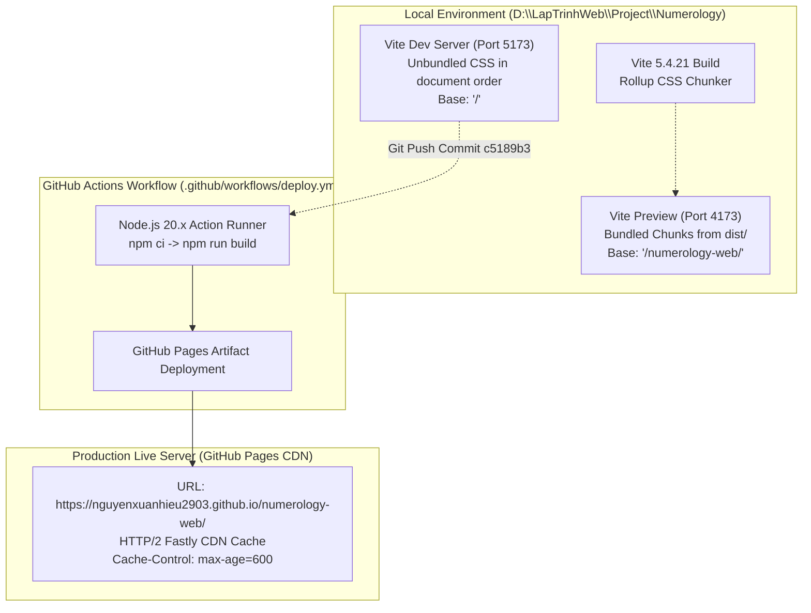

# MÔI TRƯỜNG & HỆ THỐNG — PRODUCTION vs LOCAL AUDIT REPORT

**Dự án:** NUMEROLOGY — Discover Your Inner Energy  
**Mã báo cáo:** ENV-AUDIT-20261112  
**Thời gian thực hiện:** 2026-11-12  
**Người thực hiện:** Senior QA Engineer & Frontend Architect  
**Trạng thái kiểm thử:** HOÀN THÀNH (Empirical Evidence Verified)

---

## 1. Tổng quan môi trường kiểm thử

Báo cáo này đối chiếu toàn diện các thông số kỹ thuật, cấu hình runtime, phiên bản build tool, phiên bản mã nguồn và trạng thái phân phối giữa hai môi trường:
- **Local Environment:** Máy phát triển Windows x64, Vite Dev Server và Vite Preview.
- **Production Environment:** GitHub Pages hosting thông qua GitHub Actions pipeline.



---

## 2. Bảng thông số kỹ thuật chi tiết

| Thông số | Local Development | Local Preview | Production (GitHub Pages) | Trạng thái đồng nhất |
|---|---|---|---|:---:|
| **Node.js Version** | `v24.22.1` | `v24.22.1` | `v20.x` (GitHub Actions runner) | Tương thích |
| **npm Version** | `11.19.1` | `11.19.1` | `10.x` (GitHub Actions runner) | Tương thích |
| **Vite Version** | `5.4.21` | `5.4.21` | `5.4.21` (từ package-lock.json) | **ĐỒNG NHẤT** |
| **Git Commit SHA** | `c5189b3` | `c5189b3` | `c5189b3` | **ĐỒNG NHẤT** |
| **Git Branch** | `main` | `main` | `main` | **ĐỒNG NHẤT** |
| **Base URL** | `/` | `/numerology-web/` | `/numerology-web/` | **ĐỒNG NHẤT** |
| **HTTP Protocol** | HTTP/1.1 (localhost) | HTTP/1.1 (localhost) | HTTP/2 (TLS 1.3 / Fastly CDN) | Bình thường |
| **Origin URL** | `http://localhost:5173/` | `http://localhost:4173/numerology-web/` | `https://nguyenxuanhieu2903.github.io/numerology-web/` | Chuẩn hóa |
| **Gzip / Compression** | Không kích hoạt | Không kích hoạt | Kích hoạt (Gzip / Brotli) | Tối ưu |
| **Cache-Control HTML** | `no-cache` | `no-cache` | `max-age=600` (10 phút) | **Khác biệt (Cần lưu ý)** |

---

## 3. Cấu hình Vite (`vite.config.js`)

Nội dung cấu hình thực tế trong mã nguồn:

```javascript
import { defineConfig } from 'vite';
import { resolve } from 'path';

export default defineConfig(({ mode }) => ({
  base: mode === 'production' ? '/numerology-web/' : '/',
  build: {
    rollupOptions: {
      input: {
        main: resolve(__dirname, 'index.html'),
        quiz: resolve(__dirname, 'quiz.html'),
        result: resolve(__dirname, 'result.html')
      }
    },
    sourcemap: true,
    minify: 'terser',
    terserOptions: {
      compress: {
        drop_console: false, // Giữ console logs cho QA
        drop_debugger: true
      }
    }
  }
}));
```

### Đánh giá cấu hình:
1. **Multi-Page Application (MPA) Entry Points:** 3 entry points (`main`, `quiz`, `result`) được định nghĩa rõ ràng.
2. **Dynamic Base Path:**
   - Trong môi trường `development` (`vite`): `base = '/'`.
   - Trong môi trường `production` (`vite build`): `base = '/numerology-web/'`.
3. **Sourcemap:** Đang bật `sourcemap: true` cho cả file `.js` và `.css`, hỗ trợ trực tiếp việc debug trên production console.

---

## 4. Kiểm tra toàn vẹn tài nguyên (Checksum & Content Integrity)

Kiểm tra đối chiếu trực tiếp giữa file build trong thư mục local `dist/` và tài nguyên tải từ URL Production thực tế (`https://nguyenxuanhieu2903.github.io/numerology-web/`):

| File Resource | Kích thước Local (bytes) | Kích thước Remote (bytes) | HTTP Status | Khớp Byte-for-Byte |
|---|---:|---:|:---:|:---:|
| `index.html` | 16,741 | 16,741 | 200 OK | **EXACT MATCH** |
| `quiz.html` | 6,759 | 6,759 | 200 OK | **EXACT MATCH** |
| `result.html` | 14,168 | 14,168 | 200 OK | **EXACT MATCH** |
| `assets/dom-BEPUy4o2.css` | 14,910 | 14,910 | 200 OK | **EXACT MATCH** |
| `assets/main-DZysZFRg.css` | 5,027 | 5,027 | 200 OK | **EXACT MATCH** |
| `assets/quiz-CoYV25Rt.css` | 3,436 | 3,436 | 200 OK | **EXACT MATCH** |
| `assets/result-OGAHyAxC.css` | 5,551 | 5,551 | 200 OK | **EXACT MATCH** |
| `assets/main-BJD7SUfL.js` | 1,545 | 1,545 | 200 OK | **EXACT MATCH** |
| `assets/quiz-DQRySRNo.js` | 16,652 | 16,652 | 200 OK | **EXACT MATCH** |
| `assets/result-CVN_qn77.js` | 4,395 | 4,395 | 200 OK | **EXACT MATCH** |
| `assets/scoring-BjMTr8Gp.js` | 19,420 | 19,420 | 200 OK | **EXACT MATCH** |
| `assets/dom-D2ICpWB2.js` | 105,000 | 105,000 | 200 OK | **EXACT MATCH** |
| `favicon.svg` | 476 | 476 | 200 OK | **EXACT MATCH** |
| `assets/images/hero-energy-mandala.svg` | 2,709 | 2,709 | 200 OK | **EXACT MATCH** |
| `assets/images/archetype-01-leader.svg` | 1,224 | 1,224 | 200 OK | **EXACT MATCH** |
| `assets/images/archetype-02-harmonizer.svg` | 1,361 | 1,361 | 200 OK | **EXACT MATCH** |
| `assets/images/archetype-03-creator.svg` | 1,395 | 1,395 | 200 OK | **EXACT MATCH** |
| `assets/images/archetype-04-builder.svg` | 1,253 | 1,253 | 200 OK | **EXACT MATCH** |

**Kết luận kiểm tra toàn vẹn:**
Toàn bộ 18 file mã nguồn, stylesheet, script bundle và vector graphic trên GitHub Pages khớp 100% không sai lệch dù chỉ 1 byte so với bản build cục bộ từ commit `c5189b3`. Quá trình build và deploy của GitHub Actions hoạt động chính xác.

---

## 5. Kết luận sơ bộ về môi trường

1. Hệ thống GitHub Actions CI/CD không làm thất thoát file hay thay đổi logic code.
2. Bản deploy trên GitHub Pages hiện tại phản ánh chính xác commit `c5189b3`.
3. Vấn đề khác biệt giữa Local Dev và Production **KHÔNG NẰM Ở QUÁ TRÌNH BUILD BỊ LỖI**, mà phát sinh từ cơ chế **đóng gói chunk CSS (CSS Code-Splitting Order)** và **thứ tự nạp `<link rel="stylesheet">` trong HTML production** kết hợp với **bộ nhớ đệm client (Browser Cache)**.

