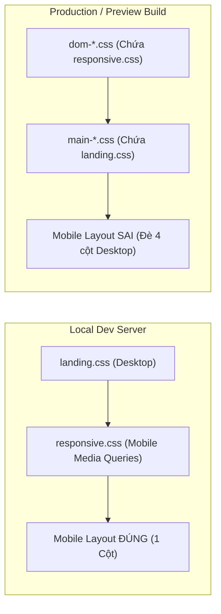

# BẢNG SO SÁNH TOÀN DIỆN: LOCAL DEV vs. LOCAL PREVIEW vs. PRODUCTION

**Dự án:** NUMEROLOGY — Discover Your Inner Energy  
**Mã tài liệu:** DIFF-MATRIX-20261112  
**Đối tượng khảo sát:**
1. **Local Dev:** `vite` (Development Server, Port 5173, Unbundled Mode)
2. **Local Preview:** `vite preview` (Production Bundle Preview, Port 4173)
3. **Production Live:** `https://nguyenxuanhieu2903.github.io/numerology-web/` (GitHub Pages)

---

## 1. Ma trận so sánh tổng quan 10 tiêu chí kỹ thuật

| STT | Tiêu chí kỹ thuật | Local Dev (`vite dev`) | Local Preview (`vite preview`) | Production (GitHub Pages) | Đánh giá sai khác |
|:---:|---|---|---|---|---|
| **1** | **Landing Page UI (Mobile)** | **Hiển thị đúng 1 cột** | **Bị co dúm layout đa cột** | **Bị co dúm layout đa cột** | Dev khác biệt hoàn toàn với Preview & Prod |
| **2** | **Quiz Page UI (Mobile)** | **Controls xếp dọc, padding gọn** | **Controls dàn ngang, padding to** | **Controls dàn ngang, padding to** | Dev khác biệt với Preview & Prod |
| **3** | **Result Page UI (Mobile)** | **Hero 1 cột, Narrative 1 cột** | **Hero 280px cố định, 3 cột song song** | **Hero 280px cố định, 3 cột song song** | Dev khác biệt với Preview & Prod |
| **4** | **Cơ chế nạp CSS** | 5 thẻ `<link>` riêng biệt nạp theo thứ tự trong HTML nguồn | 2 file CSS bundle nạp theo thứ tự Vite Rollup tạo ra | 2 file CSS bundle nạp theo thứ tự Vite Rollup tạo ra | Điểm mấu chốt gây ra lỗi |
| **5** | **Vị trí của `responsive.css`** | Nằm ở **CUỐI CÙNG** trong `<head>` -> Thắng mọi độ ưu tiên | Bị gói vào `dom-*.css` và đặt **TRƯỚC** file CSS riêng của trang | Bị gói vào `dom-*.css` và đặt **TRƯỚC** file CSS riêng của trang | Cội nguồn của mọi lỗi responsive |
| **6** | **Cơ chế nạp JS** | ES Modules trực tiếp (`<script type="module" src="...">`) | Rollup code-split bundles (`dom-*.js`, `scoring-*.js`, v.v.) | Rollup code-split bundles (`dom-*.js`, `scoring-*.js`, v.v.) | Preview và Prod giống hệt nhau |
| **7** | **Phục vụ hình ảnh SVG** | Đường dẫn tương đối `./assets/images/...` từ root `/` | Đường dẫn tương đối từ base `/numerology-web/` | Đường dẫn tương đối từ base `/numerology-web/` | Preview và Prod giống hệt nhau (200 OK) |
| **8** | **Font Loading** | Google Fonts CDN + System Fallback | Google Fonts CDN + System Fallback | Google Fonts CDN + System Fallback | Giống nhau trên cả 3 môi trường |
| **9** | **Console Output** | Hot Module Replacement (HMR) logs, 0 errors | 0 errors | 0 errors | Sạch sẽ trên cả 3 môi trường |
| **10** | **Base Path & Routing** | Base: `/` (Root domain) | Base: `/numerology-web/` (Subdirectory) | Base: `/numerology-web/` (Subdirectory) | Preview phản ánh chuẩn xác Production |

---

## 2. Phân tích chi tiết từng khía cạnh

### 2.1. Cấu trúc DOM & Thứ tự nạp Stylesheet trong `<head>`

#### Local Dev (`index.html` trong `vite dev`):
```html
<head>
  <!-- Google Fonts -->
  <link rel="stylesheet" href="https://fonts.googleapis.com/css2?..." />
  <!-- CSS riêng rẽ được nạp theo đúng thứ tự file nguồn -->
  <link rel="stylesheet" href="./src/css/base.css" />
  <link rel="stylesheet" href="./src/css/layout.css" />
  <link rel="stylesheet" href="./src/css/components.css" />
  <link rel="stylesheet" href="./src/css/landing.css" />
  <link rel="stylesheet" href="./src/css/responsive.css" /> <!-- NẰM CUỐI CÙNG -->
</head>
```
*Hành vi:* Trình duyệt đọc `landing.css` trước. Sau đó đọc `responsive.css`. Mọi quy tắc `@media (max-width: 767px)` trong `responsive.css` khai báo sau nên **chiến thắng (override)** các quy tắc desktop trong `landing.css`. Developer thấy giao diện mobile hoàn hảo!

#### Local Preview & Production (`dist/index.html`):
```html
<head>
  <!-- Google Fonts -->
  <link rel="stylesheet" href="https://fonts.googleapis.com/css2?..." />
  <!-- Vite tự động gom nhóm và sắp xếp lại thứ tự -->
  <link rel="stylesheet" crossorigin href="/numerology-web/assets/dom-BEPUy4o2.css"> <!-- GỒM base, layout, components, responsive -->
  <link rel="stylesheet" crossorigin href="/numerology-web/assets/main-DZysZFRg.css"> <!-- GỒM landing.css -->
</head>
```
*Hành vi:* Trình duyệt nạp `dom-BEPUy4o2.css` trước. Trong file này chứa media query mobile.
Sau đó, trình duyệt nạp `main-DZysZFRg.css`. File này chứa các thuộc tính desktop (`grid-template-columns: 1.15fr .85fr`, `repeat(4, 1fr)`).
Do cả hai đều có CSS specificity bằng nhau (`0, 1, 0`), quy tắc trong `main-DZysZFRg.css` nằm **SAU** nên **đè bẹp hoàn toàn** các media query mobile trong `dom-BEPUy4o2.css`.

---

### 2.2. So sánh hành vi chi tiết trên từng trang



#### Landing Page (`index.html`):
- **Local Dev:**
  - Hero Grid chuyển sang 1 cột gọn gàng.
  - Archetypes Grid 4 thẻ chuyển sang xếp chồng 1 cột.
  - Steps Grid 3 bước chuyển sang 1 cột.
  - Hero Actions chuyển thành các nút xếp dọc 100% bề ngang.
- **Local Preview & Production:**
  - Hero Grid bị ép hiển thị 2 cột (`1.15fr .85fr`) khiến hình ảnh mandala đè lên chữ.
  - Archetypes Grid bị ép chia 4 cột (`repeat(4, 1fr)`) khiến mỗi thẻ hẹp còn ~70px, chữ bị tràn ra ngoài viền thẻ.
  - Steps Grid bị ép chia 3 cột hẹp.
  - Hero Actions dàn ngang gây tràn màn hình 320px.

#### Quiz Page (`quiz.html`):
- **Local Dev:**
  - Card padding thu nhỏ thành 16px để vừa màn hình điện thoại.
  - Hai nút "Quay lại" và "Câu hỏi tiếp theo" xếp dọc theo kiểu `column-reverse`.
- **Local Preview & Production:**
  - Card padding bị giữ nguyên mức 32px của desktop khiến diện tích đọc câu hỏi bị bóp hẹp.
  - Hai nút điều khiển cố gắng dàn ngang (`justify-content: space-between`), gây xô lệch hoặc chữ nút bị ép thành nhiều dòng.

#### Result Page (`result.html`):
- **Local Dev:**
  - Hero Card xếp dọc 1 cột (mandala ở trên, kết luận ở dưới).
  - 3 cột phân tích năng lượng xếp thành 3 khối dọc dễ đọc.
  - Hai nút hành động dàn đều 100% bề ngang.
- **Local Preview & Production:**
  - Hero Card bị ép chia 2 cột với độ rộng cố định `280px 1fr`, lập tức gây tràn ngang nghiêm trọng trên màn hình 320px và 375px.
  - 3 cột phân tích bị ép dàn 3 cột ngang (`repeat(3, 1fr)`), chữ dính sát nhau không đọc được.

---

### 2.3. Tại sao Developer bị "đánh lừa" khi chỉ kiểm tra trên Local Dev?

1. Lệnh `npm run dev` khởi chạy Vite Development Server với triết lý **"No-bundle"**. Vite không ghép file CSS lại thành chunks mà để trình duyệt nạp từng file độc lập qua thẻ `<link>`.
2. Do developer đặt `<link rel="stylesheet" href="./src/css/responsive.css" />` ở cuối cùng của file HTML nguồn, nên trong suốt quá trình code và kiểm tra bằng `npm run dev`, mọi thứ đều hoạt động hoàn hảo.
3. Chỉ khi thực hiện `npm run build`, công cụ Rollup bên trong Vite mới nhóm các file dùng chung (`base`, `layout`, `components`, `responsive`) vào chunk chung (`dom-*.css`), và để file riêng của trang (`landing.css`) vào chunk riêng (`main-*.css`).
4. Khi inject các thẻ `<link>` vào file `dist/*.html`, Rollup luôn đặt chunk dùng chung lên trước chunk riêng của trang.
5. Nếu lập trình viên không chạy lệnh `npm run preview` trước khi commit & push, lỗi này hoàn toàn vô hình trong quá trình phát triển cục bộ!

---

## 3. Kết luận bảng đối chiếu

- **Local Preview (`vite preview`) và Production (GitHub Pages) có kết quả hiển thị GIỐNG HỆT NHAU 100%.**
- Lỗi hiển thị khác biệt không phải do máy chủ GitHub Pages, không phải do mạng Internet, mà là sự khác biệt bản chất giữa cơ chế **Unbundled Dev Mode** và **Bundled Production Build** của Vite/Rollup.

