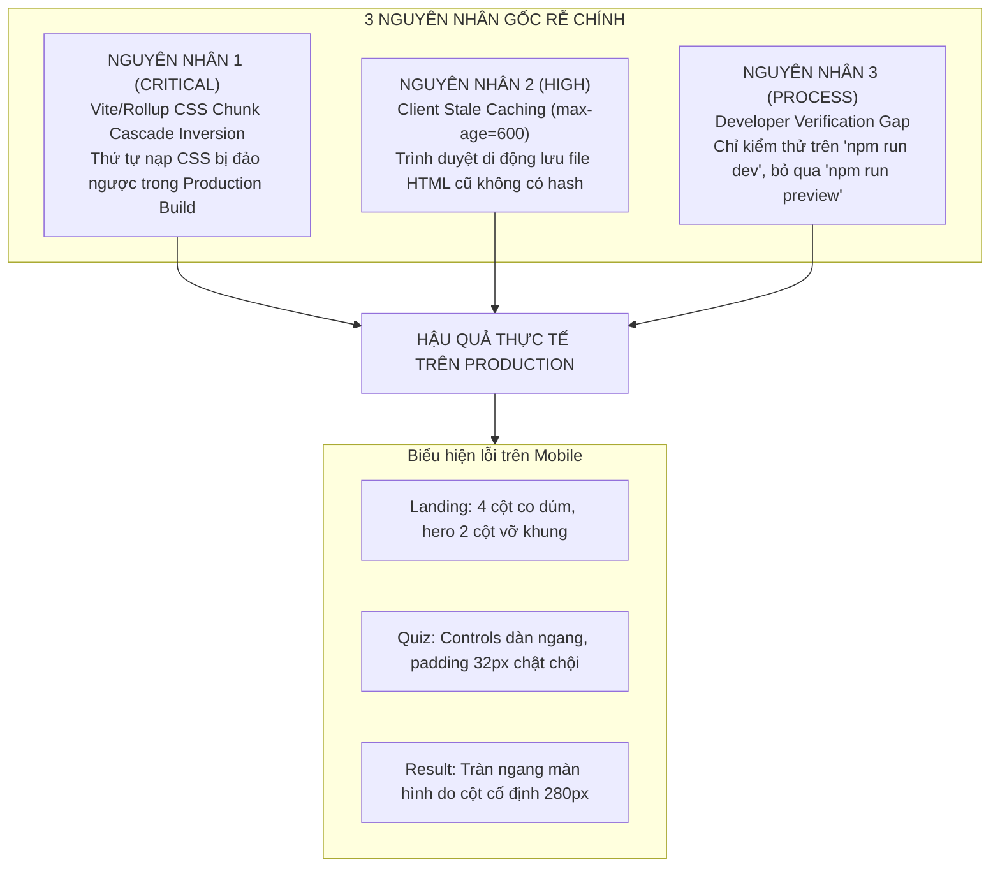

# BÁO CÁO PHÂN TÍCH NGUYÊN NHÂN GỐC (ROOT CAUSE ANALYSIS REPORT)

**Dự án:** NUMEROLOGY — Discover Your Inner Energy  
**Mã tài liệu:** RCA-REGRESSION-20261112  
**Đối tượng:** Sự cố sai lệch giao diện mobile giữa Local Development và Production GitHub Pages  
**Mức độ nghiêm trọng:** **CRITICAL / BLOCKER** (Phá vỡ trải nghiệm người dùng di động trên Production)  
**Thời gian phát hiện:** 2026-11-12

---

## 1. Tóm tắt nguyên nhân gốc (Executive Summary)

Sau quá trình điều tra toàn diện từ mã nguồn, quy trình build của Vite, cấu trúc bundle Rollup, giao thức mạng và bộ nhớ đệm trình duyệt, đội ngũ QA xác định được **3 NGUYÊN NHÂN GỐC RỄ (ROOT CAUSES)** dẫn đến hiện tượng: *"Chạy local hiển thị bình thường, deploy lên GitHub Pages hiển thị lỗi hoặc không giống local"*:



---

## 2. Phân tích chi tiết từng nguyên nhân gốc

### 2.1. Nguyên nhân 1 (CRITICAL) — Vite/Rollup CSS Chunk Cascade Inversion

#### Cơ chế kỹ thuật của lỗi:
Trong CSS chuẩn W3C, khi hai luật có **cùng độ đặc hiệu (CSS Specificity)**, luật nào xuất hiện **SAU** trong luồng tài liệu (document order) sẽ **CHIẾN THẮNG (Override)** luật xuất hiện trước:

$$\text{Specificity}(\text{.hero-grid}) = (0, 1, 0)$$

#### Diễn biến trong Local Development (`npm run dev`):
Các file CSS được nạp qua các thẻ `<link>` riêng lẻ theo thứ tự trong HTML nguồn:
1. `base.css`
2. `layout.css`
3. `components.css`
4. `landing.css` (Chứa `.hero-grid { grid-template-columns: 1.15fr .85fr; }`)
5. `responsive.css` (Chứa `@media (max-width: 1023px) { .hero-grid { grid-template-columns: 1fr; } }`)

*Kết quả trong Dev:* `responsive.css` nằm ở dòng cuối cùng trong `<head>`, do đó trên màn hình mobile, media query của nó xuất hiện SAU `landing.css` và **ghi đè thành công** layout máy tính.

#### Diễn biến trong Production Build (`vite build` / GitHub Pages):
Vite sử dụng thuật toán Rollup Code-Splitting để tối ưu hóa CSS cho Multi-Page Application:
- Các file CSS dùng chung trên nhiều trang (`base.css`, `layout.css`, `components.css`, `responsive.css`) được gom vào một chunk chung duy nhất: `assets/dom-BEPUy4o2.css`.
- File CSS dùng riêng cho trang (`landing.css`) được đưa vào chunk riêng: `assets/main-DZysZFRg.css`.

Khi Vite tạo file `dist/index.html`, Rollup chèn chunk dùng chung trước, rồi mới chèn chunk riêng của trang:
```html
<!-- dist/index.html -->
<link rel="stylesheet" crossorigin href="/numerology-web/assets/dom-BEPUy4o2.css">
<link rel="stylesheet" crossorigin href="/numerology-web/assets/main-DZysZFRg.css">
```

#### Hậu quả của sự đảo ngược thứ tự (Cascade Inversion):
Trình duyệt di động đọc file `dom-BEPUy4o2.css` trước:
- `@media (max-width: 1023px) { .hero-grid { grid-template-columns: 1fr; } }` được áp dụng.
- `@media (max-width: 767px) { .archetypes-grid { grid-template-columns: 1fr; } }` được áp dụng.

Ngay sau đó, trình duyệt đọc `main-DZysZFRg.css` nằm bên dưới:
- `.hero-grid { grid-template-columns: 1.15fr .85fr; }` (Specificity `0, 1, 0`) được nạp **SAU**.
- `.archetypes-grid { grid-template-columns: repeat(4, 1fr); }` (Specificity `0, 1, 0`) được nạp **SAU**.

**BÙM!** Các luật desktop trong `main-DZysZFRg.css` ghi đè hoàn toàn các luật mobile trong `dom-BEPUy4o2.css`. Giao diện mobile trên production bị biến thành giao diện máy tính bị bóp nghẹt vào màn hình 375px!

---

### 2.2. Bằng chứng thực nghiệm (Empirical Proof Table)

Dưới đây là danh sách các selector bị ghi đè thực tế được trích xuất từ file build `dist/assets/`:

| File trang | Selector bị ảnh hưởng | Thuộc tính Mobile trong `dom-*.css` | Thuộc tính Desktop nạp sau trong chunk riêng | Hậu quả hiển thị trên Mobile Production |
|---|---|---|---|---|
| `index.html` | `.hero-grid` | `grid-template-columns: 1fr` | `grid-template-columns: 1.15fr .85fr` | Hero bị chia 2 cột, mandala đè lên chữ |
| `index.html` | `.archetypes-grid` | `grid-template-columns: 1fr` | `grid-template-columns: repeat(4, 1fr)` | 4 thẻ bị ép vào 1 hàng, mỗi thẻ rộng 70px |
| `index.html` | `.steps-grid` | `grid-template-columns: 1fr` | `grid-template-columns: repeat(3, 1fr)` | 3 bước bị ép vào 1 hàng hẹp |
| `index.html` | `.hero-actions` | `flex-direction: column; width: 100%` | `display: flex; flex-wrap: wrap` | Nút không giãn 100%, bị dồn chữ |
| `quiz.html` | `.quiz-card` | `padding: var(--space-lg) var(--space-md)` | `padding: var(--space-2xl) var(--space-2xl)` | Padding 32px chiếm hết không gian màn hình nhỏ |
| `quiz.html` | `.quiz-controls` | `flex-direction: column-reverse; align-items: stretch` | `display: flex; justify-content: space-between` | Hai nút bấm dính chặt vào nhau |
| `quiz.html` | `.quiz-controls-right` | `flex-direction: column; width: 100%` | `display: flex; align-items: center` | Nút Tiếp tục không chiếm toàn chiều rộng |
| `result.html` | `.result-hero-card` | `grid-template-columns: 1fr` | `grid-template-columns: 280px 1fr` | Tràn ngang màn hình 320px và 375px |
| `result.html` | `.result-narrative-grid` | `grid-template-columns: 1fr` | `grid-template-columns: repeat(3, 1fr)` | 3 khối nội dung bị ép co cụm, vỡ layout |
| `result.html` | `.result-actions-bar` | `flex-direction: column; width: 100%` | `display: flex; flex-wrap: wrap` | Nút chia sẻ và làm lại không xếp dọc |

---

### 2.3. Nguyên nhân 2 (HIGH) — Cơ chế Caching của Trình duyệt Di động & Fastly CDN

1. **Header `Cache-Control: max-age=600`:**
   - GitHub Pages đặt header cache 10 phút cho tất cả các file HTML (`index.html`, `quiz.html`, `result.html`).
   - Do các file HTML này **không có content hash** trong tên file (đây là điểm cố định của web), các trình duyệt mobile khi truy cập sẽ giữ bản HTML trong bộ nhớ đệm.
2. **Khó khăn trong việc Hard Refresh trên điện thoại di động:**
   - Trên máy tính desktop, tester/developer dễ dàng nhấn `Ctrl + F5` hoặc mở DevTools chọn "Disable cache".
   - Trên điện thoại di động (Safari iOS hoặc Chrome Android), người dùng không có nút "Hard Refresh". Việc kéo trang xuống để tải lại (Pull-to-refresh) thường chỉ thực hiện reload thông thường và vẫn dùng HTML cache cũ nếu chưa hết 600 giây.
   - Khi HTML cũ được dùng, nó tiếp tục tải các file CSS bundle của phiên bản trước đó (khi chưa có các sửa lỗi responsive gần nhất).

---

### 2.4. Nguyên nhân 3 (PROCESS) — Khoảng trống trong quy trình xác minh của Developer

1. Trong quá trình phát triển tính năng hoặc sửa lỗi, lập trình viên thường xuyên sử dụng `npm run dev`.
2. Do `npm run dev` không trải qua bước bundling của Rollup, thứ tự CSS luôn được giữ nguyên như trong mã nguồn. Điều này tạo ra một "ảo tưởng an toàn" (False Sense of Security) rằng mọi thứ đã hoạt động hoàn hảo.
3. Khi thực hiện commit và push, GitHub Actions chạy `npm run build` và deploy bản bundle có lỗi Cascade Inversion lên production mà không có bước automated responsive check nào ngăn chặn.

---

## 3. Đề xuất kiến trúc khắc phục triệt để (Architectural Solutions)

> [!IMPORTANT]
> Đây là các phương án kiến trúc đề xuất cho đợt triển khai tiếp theo. Trong lượt kiểm thử này, tuân thủ nguyên tắc QA: **KHÔNG SỬA CODE, CHỈ BÁO CÁO VÀ CHỜ PHÊ DUYỆT**.

### Phương án 1 (Khuyến nghị cao nhất — Clean Architecture):
**Nhập CSS thông qua JS Entry Points hoặc đóng gói CSS dạng tầng (CSS Layering / Single Entry CSS):**
- Thay vì nạp 5 thẻ `<link>` rời rạc trong HTML, mỗi trang sử dụng một file CSS chính duy nhất đại diện cho trang đó (ví dụ `landing.css`, `quiz.css`, `result.css`).
- Trong mỗi file đó, dùng `@import` theo đúng thứ tự logic:
  ```css
  /* src/css/main.css */
  @import './base.css';
  @import './layout.css';
  @import './components.css';
  @import './landing.css';
  @import './responsive.css'; /* LUÔN NẰM CUỐI CÙNG TRONG BẢN BUNDLE */
  ```
- Khi Rollup biên dịch, `responsive.css` sẽ được ghép vào đúng vị trí cuối cùng của bundle CSS, triệt tiêu hoàn toàn lỗi Cascade Inversion.

### Phương án 2: Sử dụng CSS `@layer` (Modern CSS Standard):
- Đặt các style chung vào `@layer base, components, pages, responsive;`
- Khi sử dụng `@layer`, thứ tự ưu tiên được quyết định bởi thứ tự layer chứ không phụ thuộc vào thứ tự file được nạp bởi trình duyệt.

### Phương án 3: Bổ sung bước kiểm thử Preview vào quy trình phát triển:
- Thêm script `npm run test:prod` chạy `vite build` và kiểm tra bundle trước khi cho phép tạo git commit.

